# 夜航船 · 全局主题实施任务清单

> 依据：`Docs/全局主题架构方案.md`（512 行，含 4 项已确认决策）
> 拆解日期：2026-11-28
> 用途：可直接派工的 vivo 级执行清单——每项都有**文件锚点、实现要点、完成标准（DoD）、前置依赖、估时**
> 估时单位：熟练 iOS/SwiftUI 工程师单人日（粗估区间，含自测，不含评审等待）

---

## 一、拆解原则（先读）

1. **每阶段可独立编译、独立回归**：阶段末尾设门禁（Gate），不通过不进入下一阶段。
2. **零视觉变化起步**：阶段 0 完成后 App 外观必须与今天完全一致，只验证「老数据能读、机制就位」。
3. **性能门禁前置**：MeshGradient 缓存机制必须在阶段 1 先落地并通过 Instruments，之后才允许在阶段 3 上编辑器——**顺序不可颠倒**。
4. **一任务一提交**：每个任务对应一个原子 commit，便于 cherry-pick 与回滚。
5. **迁移可回退**：阶段 0 的 `backend = .legacy | .dualWrite | .themeStore` 影子写开关是全局保险丝，任一阶段异常可切回 `.legacy`，无需重启、不白屏。
6. **三条边界不可突破**（见方案 §0）：系统启动屏不可改；背景（含 MeshGradient）一律静态无动画；自由定制必须带护栏。

### 关键路径（决定最短工期）

```
P0-01 → P0-03 → P0-04 → P0-07 → P1-00 → P1-01 → P1-03 → P2-01 → P3-01 → P3-03 → P3-05 → P3-07 → P4-01 → P4-02 → 发布
```
关键路径合计约 **39–48 人日**；全部任务合计约 **76–97 人日**（主席终裁口径，单人约 16–20 周，2 人并行约 10–12 周）。关键路径不变。较上一版 +1/+2 人日，来自 D20「阅读正文 CoreText 对齐」单列（P2-03/P2-04，1.5–2 人日）与 P3-06 估时上调（5–6.5 人日）。

### 统计分母口径（Phase 2 终裁 · 以提交树 HEAD 为准）
- 所有 grep 归零门禁一律基于提交树：`git grep <pattern> HEAD -- YeHangChuan/`，排除 `.claude/worktrees/`。
- 统一分母（新 HEAD `5874644`，用户睡眠定时三行已进提交树、正式纳入迁移范围，无豁免）：`.font(.system(size:` **482 处**（全口径 `.font(.system` 484 处）/ `Palette.` **654 处（608 行）** / `AppBackdrop()` **35 调用** / `.appChrome` **26 调用** / `ProgressView` **12 处（6 文件）**。
- **「调用点」≠「grep 命中行」**：`AppBackdrop()` grep 命中 36 行含 1 处定义（调用 35）；`.appChrome` grep 命中 27 行含 1 处定义（调用 26）。归零验收按调用点计，定义行不算残留。
- 旧版字体/色板计数口径（本基线之前的各版数字）一律作废，不再使用；一切归零验收以本节分母为准。

---

## 二、任务总览

| 阶段 | 主题 | 任务数 | 人日 | 门禁 |
|---|---|---:|---:|---|
| 0 | 地基（零视觉变化） | 8 | 10–13 | G0：老数据可读、外观零差异 |
| 1 | 令牌适配 + 性能前置 | 7 | 12–16 | G1：全 App 一致换肤、背景零动画、性能达标 |
| 2 | 阅读融合 | 5 | 11–13 | G2：继承/覆盖正确、字号滑块不重建整树、D20 阅读正文 CoreText 对齐 |
| 3 | 编辑器与资产 | 9 | 25–30 | G3：冷启动首帧、ZIP 往返、导入攻击防护、C-3 字体版权三段闭环 |
| 4 | 加载态统一与打磨 | 5 | 8–11 | G4：全加载态换肤、无障碍与性能门禁、activeThemeID 跨端一致/缺失 ID 回退提示、合规 A/B 三类验收 |
| 二期 | iCloud 主题跨端（P5-02~04；P5-01 已归一期） | 3 | 10–14 | G5：两端一致、冲突不静默覆盖 |
| **合计** | | **38** | **76–97** | |

> 任务数仍为 38（P5-01 由二期移入一期，总量不变）；D20 阅读正文 CoreText 对齐单列 P2-03/P2-04（1.5–2 人日）、P3-06 估时 5–6.5 人日，总盘 **76–97 人日**（主席终裁口径），关键路径不变。二期「默认关闭」总纲自 P5-02 起适用（P5-01 属一期、随 Snapshot 默认走）。

---

## 三、依赖关系图

```mermaid
graph LR
    subgraph P0["阶段0 地基"]
        A01[P0-01 模型] --> A03[P0-03 引擎]
        A02[P0-02 预设] --> A03
        A03 --> A04[P0-04 环境注入]
        A05[P0-05 ThemeStore] --> A07[P0-07 冷启动注入]
        A06[P0-06 Snapshot桥接] --> A07
        A04 --> A07
        A07 --> G0{{G0 门禁}}
    end
    subgraph P1["阶段1 令牌适配"]
        G0 --> B00[P1-00 网格缓存/性能]
        B00 --> B01[P1-01 Palette壳/背景]
        B01 --> B03[P1-03 共享组件]
        B03 --> B04[P1-04 语义字体]
        B04 --> B05[P1-05 弹层接线]
        G0 --> B02[P1-02 玻璃token]
        B02 --> B03
        B05 --> G1{{G1 门禁}}
    end
    subgraph P2["阶段2 阅读融合"]
        G1 --> C01[P2-01 阅读Resolver]
        C01 --> C02[P2-02 override字段]
        C02 --> C03[P2-03 ReaderView]
        C03 --> C04[P2-04 字体注册]
        C04 --> G2{{G2 门禁}}
    end
    subgraph P3["阶段3 编辑器与资产"]
        G2 --> D01[P3-01 资产Store]
        D01 --> D02[P3-02 字体导入]
        D01 --> D03[P3-03 编辑器IA]
        D03 --> D04[P3-04 调色]
        D03 --> D05[P3-05 网格编辑器]
        D03 --> D06[P3-06 背景/加载编辑]
        D03 --> D07[P3-07 .yhthm]
        D07 --> D08[P3-08 备份scope]
        D08 --> G3{{G3 门禁}}
    end
    subgraph P4["阶段4 打磨"]
        G3 --> E01[P4-01 ThemedLoading]
        E01 --> E02[P4-02 替换ProgressView]
        E02 --> E03[P4-03 首次动画]
        E03 --> E04[P4-04 无障碍]
        E04 --> E05[P4-05 清遗留/性能]
        E05 --> G4{{G4 门禁}}
    end
    subgraph P4B["一期并行 P5-01"]
        G3 --> F01[P5-01 ID同步 · 归一期]
    end
    subgraph P5["二期 同步（默认关闭，自 P5-02 起）"]
        F01 --> F02[P5-02 开关权限]
        F02 --> F03[P5-03 push/pull]
        F03 --> F04[P5-04 冲突UI/墓碑]
        F04 --> G5{{G5 门禁}}
    end
```



---

## 四、阶段 0 · 地基（零视觉变化）

> 目标：机制就位、外观不变。完成后用同一份老 Snapshot 跑前后截图对比，像素级一致。

### P0-01 主题领域模型
- **目标**：落地方案 §3 的全部数据结构。
- **文件**：新增 `YeHangChuan/Theme/ThemeModels.swift`。
- **实现要点**：
  - `ThemeConfig` / `ColorSpec` / `BackgroundSpec`（含 `case mesh(points:[[Double]], colors:[ColorSpec])`）/ `ReaderBackgroundSpec` / `TypographySpec` / `FontFamilySpec`（**只有 `.system` 与 `.imported`，无 `.bundled`**）/ `LoadingStyleSpec` / `ShapeSpec`。
  - `TypographySpec` 增补 `tracking`（字距，0–2pt）与 `paragraphSpacing`（段距，0–8pt）两字段（D20 数据侧），`decodeIfPresent ?? 默认` + 数值 clamp（越界回退各自默认值 0），供 P3-06 编辑界面与 P2-03 阅读正文接入共用。
  - `ThemeColor`（light/dark UInt32 + opacity）、`Theme`、`ThemeCatalog`、`AssetRef`、`ThemeSelection`、`ThemePackageManifest`。
  - 所有结构 `Codable + Sendable`；`init(from:)` 逐字段 `decodeIfPresent ?? 默认`，数值 clamp、数组限长、字符串限长。
  - `BackgroundSpec.mesh` 解码校验：`rows/cols ∈ 3...5`、`points.count == rows*cols == colors.count`，否则回退 `.systemMesh`。
- **DoD**：单元测覆盖——缺字段解码、未知枚举、未来 schemaVersion、非法网格（点数不等/越界）四类样本，均不抛错且回退正确；**C-3 合规断言**：确认 App 包内零第三方字体二进制（字体仅用户从文件 App 导入，`FontFamilySpec` 只有 `.system`/`.imported`、无 `.bundled`），入 G3 门禁。
- **依赖**：无。 **估时**：1.5–2 人日。

### P0-02 内置默认主题模板（六套预设）
- **目标**：把现有 `Palette` 色值 + 5 套 `ReaderTheme` 迁移为数据驱动的内置主题。
- **文件**：新增 `YeHangChuan/Theme/BuiltinThemes.swift`。
- **实现要点**：
  - 六套预设（夜航·原型 / 灯下旧卷 / 青瓷夜雨 / 霜天晓角 / 墨海金钩 / 竹影护眼）完整规格见方案 §5.7。
  - 「夜航·原型」必须与当前 `Palette` 深色档值**逐色一致**（作为零视觉回归基准）。
  - 每套含浅/深双档；`base`/`builtin`/`builtinRevision`/`customized` 字段就位。
  - 5 套 `ReaderTheme` 的 background/text/secondary/accent/isDark 一一映射为 reader-only 模板。
- **DoD**：单元测试逐色断言「夜航·原型 == 当前 Palette」；6 套主题全部可解码、可序列化往返。
- **依赖**：P0-01。 **估时**：1–1.5 人日。

### P0-03 主题引擎与解析
- **目标**：配置 + ColorScheme → `ThemeTokens`。
- **文件**：新增 `YeHangChuan/Theme/ThemeEngine.swift`。
- **实现要点**：
  - `resolve(config:scheme:)` 产出具体 `Color/Font/ResolvedBackground/ResolvedReaderStyle`。
  - `ColorSpec.system` 走现有 `Color.adaptive` 动态 provider（系统明暗切换不重建视图）；自定义色按 scheme 取 light/dark 档。
  - `revision` 计算：仅主题真实变化才递增，`ThemeTokens.==` 只比较 revision。
  - 对比度校验函数（正文 4.5:1 / 大字 3:1 / 图形 3:1）按 **WCAG 相对亮度线性化算法**计算（sRGB 逐通道线性化后加权，非简单灰度均值）；叠加护眼层最坏情况再验；本任务**只输出警告列表、不强制拒绝**（与 P3-04 的「一键修正」闭环配合，见 C-6）。
  - **此任务先定义 `ResolvedBackground` 结构骨架（网格点/色数组一次算好），具体缓存在 P1-00 落地。**
- **DoD**：同配置不同 scheme 解析出两套令牌；非法值走兜底不崩溃；对比度函数对已知色对断言正确。
- **依赖**：P0-01、P0-02。 **估时**：1.5–2 人日。

### P0-04 环境注入与字体语义适配骨架
- **目标**：`ThemeTokens` 注入视图树，`themedChrome` 扩展点就位。
- **文件**：新增 `YeHangChuan/Theme/ThemeTokens.swift`。
- **实现要点**：
  - `EnvironmentKey` + `@Environment(\.theme)` + 默认值 = 内置默认主题解析结果。
  - `View+themedLoading(isLoading:label:)` 与 `View+themeFont(_:)` 的**接口定义**（实现体可先空转）。
  - `.themedChrome(store)` = 主题环境 + `.preferredColorScheme` + 护眼层，签名对齐现有 `.appChrome(store)`（**Theme.swift:217 定义**，非 206；应用调用点 26 处 / grep 命中 27 行含 1 处定义）。
- **DoD**：编译通过；未注入时 `@Environment(\.theme)` 拿到默认主题，视图无异常。
- **依赖**：P0-03。 **估时**：1 人日。

### P0-05 ThemeStore 独立持久化
- **目标**：`Themes/themes.json` + 资产目录 + 版本兼容 + dualWrite 影子写。
- **文件**：新增 `YeHangChuan/Theme/ThemeStore.swift`。
- **实现要点**：
  - 目录布局见方案 §6.1；索引写前轮转 `.prev.json`（仅当前可读时）；坏文件改名 `.corrupt-<ts>.json` + 写 `theme-decode-error.txt`。
  - `bootstrap()`：读 themes.json → 失败读 prev → 逐主题兜底（坏主题记入 `skippedThemes`，不阻断整份）→ `schemaVersion` 串行升级 → 未来版本只读不写盘 → 内置主题按 `builtinRevision` 刷新（未 customized 才覆盖）。
  - 写：`sequence` 防旧覆盖、200ms 合并、进后台 flush；索引 `.atomic + .sortedKeys`。
  - `backend = .legacy | .dualWrite | .themeStore`：dualWrite 阶段旧字段继续写 + 影子写，对账「令牌 == 旧 Palette 值」且「activeTheme == ReaderSettings.theme」。
- **DoD**：老文件（无主题）可读；坏文件留档不覆盖；未来版本只读不写盘；dualWrite 影子写通道就位且可一键切回 `.legacy`。（**对账门禁后移**：「令牌 == 旧 Palette 值」且「activeTheme == ReaderSettings.theme」的 dualWrite 对账脚本，须待令牌实现就位后在 P1-01 之后执行，见 P1-01 DoD。）
- **依赖**：P0-01、P0-02。 **估时**：2.5–3 人日。

### P0-06 Snapshot 桥接字段
- **目标**：Snapshot 只加极小可选字段，主题本体不并入。
- **文件**：修改 `Models.swift:1714` `AppStore.Snapshot`、`Models.swift:1728` CodingKeys、`Models.swift:2045` `apply(_:)`、`Models.swift:1813` `saveSnapshot()`。
- **实现要点**：
  - 新增 `themeSelection: ThemeSelection?`（`activeThemeID` + `catalogSchemaVersion`），`decodeIfPresent` 兜底 nil。
  - `apply` 中只设置选择，不加载主题本体；缺字段保持现状。
  - 导出快照时携带该字段（供一期 iCloud 同步，P5-01 使用）。
- **DoD**：老 Snapshot（无该字段）加载后外观不变；新字段可写入并回读；`exportedSnapshotData()` 含该字段。
- **依赖**：P0-01、P0-05。 **估时**：0.5–1 人日。

### P0-07 冷启动同步读取与根部注入
- **目标**：主题在首帧前就绪，避免闪默认色。
- **文件**：修改 `YeHangChuanApp.swift:3` `@main`、`:17` WindowGroup、`:25` RootView、`:73` preferredColorScheme、`:84`/`:179` SnapshotAutosaver。
- **实现要点**：
  - `AppStore.init()` 顺序调整为 `loadThemeSynchronously() → runLibraryMigration() → loadSnapshot() → loadReadingRecords()`；主题读只读 JSON（几十 ms），**不解码图片/字体**。
  - `WindowGroup` 根部 `.environment(store)` 后立即 `.environment(\.theme, resolved)` + `.preferredColorScheme`；不用 `onAppear` 切换、不加过渡动画。
  - 新增 `ThemeApplicator` 零尺寸叶子（仿 `:179` SnapshotAutosaver），负责落盘与字体注册；**字体注册改在 catalog 解码完成之后、ThemeApplicator 首次 `appear` 时触发**（`App.init()` 拿不到 assetIDs——store 的 `@State` 在 `App.init` 内才触发 `AppStore.init`），首帧以系统 serif 占位、注册完成后刷新一次，不阻塞冷启动；`App.init()` 不再预留 `FontRegistry.registerAll()` 调用点（P2-04 实现注册体）。
- **DoD**：冷启动首帧即用户主题（此阶段为默认主题，外观不变）；主题切换不重建 RootView；Instruments 确认无额外 body 重建；字体注册不拖慢首帧（serif 占位→注册后单次刷新）。
- **依赖**：P0-04、P0-05、P0-06。 **估时**：1.5–2 人日。

### P0-08 【G0 门禁】阶段 0 回归
- **目标**：确认地基无视觉回归。
- **执行项**：
  1. 用同一份老 Snapshot 跑前后截图对比（书架/阅读/统计/设置/弹层各一张），像素级一致。
  2. 老版本数据、坏文件、未来版本、dualWrite 对账四类样本逐一验证。
  3. 冷启动 20 次，无闪色、无崩溃。
  4. `git tag theme-p0-gate`。
- **依赖**：P0-07。 **估时**：1–1.5 人日。

---

## 五、阶段 1 · 令牌适配（含性能前置）

> 目标：换内置主题时全 App 一致换肤，背景保持静态。**P1-00 必须先于任何背景/网格编辑器工作。**

### P1-00 【性能前置】网格解析缓存机制
- **目标**：把 MeshGradient 的点/色解析为一次性缓存，30+ 处挂载共用，杜绝 body 内重建。
- **文件**：`ThemeEngine.swift`、`Theme.swift:101` `AppBackdrop`、新增 `ResolvedBackground`。
- **实现要点**：
  - `ThemeEngine.resolve(background:)` 一次生成 `ResolvedBackground`（points/colors 数组算好），存入 `ThemeTokens`。
  - `ThemeBackdrop` 从缓存读，**禁止 `repeatForever`**；沿用 `Color.clear.overlay + clipped + ignoresSafeArea` 尺寸技巧。
  - 图片背景用统一 `ThemeImageLoader` 降采样缓存（此任务先支持纯色/线性/径向/mesh，图片在 P3-01 接入）。
  - Instruments 基线：切页/弹层/滚动时背景视图重建次数为 0，无永续动画。
- **DoD**：**性能门禁通过后才允许进入 P1-01**——30+ 处背景挂载共享同一缓存实例；换主题时仅一次 `withAnimation(.easeInOut)` 淡入；滚动/切页无掉帧（60fps 稳定）。
- **依赖**：G0。 **估时**：2–3 人日。

### P1-01 Palette 降级壳 + 背景读令牌
- **目标**：`Palette` 从唯一真源降级为内置默认常量壳（标注 deprecated），`AppBackdrop` 读令牌。
- **文件**：`Theme.swift:45` `Palette`、`:101` `AppBackdrop`。
- **实现要点**：
  - `Palette` 保留静态常量供未迁移代码与预览使用，加 `deprecated` 注释，不改其数值（零回归基准）。
  - `AppBackdrop` 改为从 `@Environment(\.theme)` 读 `ResolvedBackground`；保持静态、无动画。
  - 光斑 ≤ 3、静态，颜色取主题 accentSolid / jade。
- **DoD**：默认主题下外观零变化；`Palette.` 引用数不再增加（防止新增代码继续用旧方式）；**执行从 P0-05 后移来的 dualWrite 对账门禁**——令牌解析值与旧 Palette 值逐色一致、`activeTheme == ReaderSettings.theme`，对账脚本无差异方可进入 P1-02。
- **依赖**：P1-00。 **估时**：1 人日。

### P1-02 玻璃与形状 modifier 读 token
- **目标**：`glassSurface/glassCircle/glassCapsule` 读 `ShapeSpec`。
- **文件**：`Theme.swift:206`、`:225` extension View。
- **实现要点**：
  - radius 默认 26 → `ShapeSpec.cornerRadiusScale`；玻璃高光描边透明度 → `hairlineWidth`；tint → `glassTintOpacity`。
  - 保留参数覆盖能力，兼容现有调用签名（避免一次改太多）。
- **DoD**：默认主题下玻璃观感不变；改 ShapeSpec 后卡片/按钮/胶囊同步变化。
- **依赖**：G0。 **估时**：0.5–1 人日。

### P1-03 共享组件迁移（9 个组件）
- **目标**：迁移被全 App 复用的共享组件，一次改动覆盖大部分界面。
- **文件**：`Theme.swift` — `GlassIconButton:284`、`SectionHeading:316`、`ProgressBar:338`、`RingProgress:364`、`BookCover:403`、`ToastView:498`、`SettingsRow:526`、`GlassSegmented:581`、`PressableStyle:305`（D20 组件级配色/字族；`scale` 参数 0.92/0.97/0.985 原样保留、不归一）。
- **实现要点**：
  - 组件内写死的 `Palette.*` → `@Environment(\.theme)` 对应令牌。
  - **默认参数陷阱**：`var tint: Color = Palette.accent` → `var tint: Color? = nil`，body 内 `let c = tint ?? theme.accent`。这是唯一改变调用语义处。
  - 触控尺寸下限 44pt 不得缩小；封面白字对比度护栏接入。
- **DoD**：9 个组件全部无 `Palette.` 直接引用；切换内置主题后这些组件同步换肤；现有调用点编译无报错；`PressableStyle` 的 `scale` 三档（0.92/0.97/0.985）保持不变。
- **依赖**：P1-01、P1-02。 **估时**：2–2.5 人日。

### P1-04 语义字体适配（482 处 size 口径，分批）
- **目标**：按语义角色迁移字体，字面数值先作为 uiScale 乘数保留，观感零回归。
- **文件**：`ThemeTokens.swift`（`View+themeFont` 实现）、`Theme.swift:284+` 组件、`ReaderView.swift`（**90 处**，勘误非 88）、`SettingsView.swift`（76）、`SourceView.swift`（72）、`LibraryExtras.swift`（55）、`Labs.swift`（52）、`ShelfView.swift`（31）、`YeHangChuanApp.swift`（27）、`JSSandboxSheet.swift`（25）、`ExcerptView.swift`（24）、`StatsView.swift`（17）。
- **实现要点**：
  - 定义 `.appTitle/.appBody/.appCaption/.readerBody` 语义角色；先迁标题/正文/脚注三类，剩余字面值保留。
  - Dynamic Type：`@ScaledMetric` / `.dynamicTypeSize`，主题只给基准值不覆盖系统缩放。
  - **不在本任务替换阅读正文/`ReaderPagination` 的字体**（属阶段 2）。
- **DoD**：语义角色字体随主题 `TypographySpec.uiFamily` 变化；482 处（`.font(.system(size:` size 口径，全口径 `.font(.system` 为 484 处）中标题/正文/脚注角色已迁移；系统字体大小偏好调整后布局正常。
- **依赖**：P1-03。 **估时**：3–4 人日。

### P1-05 弹层 themedChrome 全量接线
- **目标**：每个 sheet/fullScreenCover 都注入主题环境（独立宿主，盖不住根视图环境）。
- **文件**：`SourceView.swift`、`LibraryExtras.swift`、`SettingsView.swift`、`ReaderView.swift`、`Labs.swift`、`ExcerptView.swift`、`JSSandboxSheet.swift` 中所有 `.appChrome(store)` 调用点。
- **实现要点**：全量替换为 `.themedChrome(store)`；逐个核对弹层（含 alert/confirmationDialog 的自定义视图）。
- **DoD**：`grep -r '\.appChrome' YeHangChuan/` 结果为 0；逐个打开每个弹层确认主题生效（尤其护眼层与玻璃弹层叠加）。
- **依赖**：P0-04、P1-04（可部分并行：P1-05 的接线不依赖字体迁移完成）。 **估时**：1.5–2 人日。

### P1-06 【G1 门禁】令牌适配验收
- **执行项**：
  1. 切换 6 套内置主题，书架/阅读/统计/设置/所有弹层截图一致换肤，无遗漏控件。
  2. 背景零动画：录屏 10s 确认静止；Instruments 确认无 `repeatForever`。
  3. 性能：滚动书架 100 次、开关 10 个弹层，掉帧率 0；与阶段 0 基线对比无劣化。
  4. `git tag theme-p1-gate`。
- **依赖**：P1-00、P1-05。 **估时**：1 人日。

---

## 六、阶段 2 · 阅读融合

### P2-01 ReaderStyleResolver 继承/覆盖
- **目标**：产出 `ResolvedReaderStyle`，实现方案 §4.3 的优先级链。
- **文件**：新增 `YeHangChuan/Theme/ReaderStyleResolver.swift`。
- **实现要点**：
  - 优先级：阅读页显式覆盖 > 阅读页选中预设 > 全局主题 > 内置默认。
  - `followGlobalTheme==true` 取全局 reader；false 取 `preset`/`customReaderBackground`；提供「恢复跟随全局」。
  - 字体维度独立：`fontFollowGlobal` 控制字族跟随，`fontSize/lineSpacing` 仍归 `ReaderSettings`。
  - 5 套 `ReaderTheme` 作为 reader-only 模板，选中时写完整快照。
- **DoD**：单元测试覆盖 4 级优先级组合 + 切换回跟随全局；旧 `ReaderSnapshot` 可解码。
- **依赖**：G1。 **估时**：1.5–2 人日。

### P2-02 ReaderSettings.override 字段
- **目标**：把 `ReaderThemeOverride` 并入 `ReaderSettings`，沿用逐字段兜底。
- **文件**：`Models.swift:440` `ReaderSnapshot`、`:458` CodingKeys、`:420` `apply(_:)`。
- **实现要点**：
  - 新增 `override: ReaderThemeOverride = .init()`；`decodeIfPresent ?? 默认`。
  - 枚举用 `try? ... flatMap { $0 } ?? default`，与现有 14 项一致。
  - 旧快照缺字段 → 默认 `followGlobalTheme=true`，行为与今天一致。
- **DoD**：老 ReaderSnapshot 加载后阅读页外观不变；override 可写入回读。
- **依赖**：P2-01。 **估时**：0.5–1 人日。

### P2-03 ReaderView 接入 ResolvedReaderStyle
- **目标**：阅读页视觉全部走解析结果；与 P2-04 共同承载 D20「阅读正文 CoreText 对齐」（**单列 1.5–2 人日，在 P2-03/P2-04 之间分摊**，不压进 P3-06；三段归属 = P0-01 数据字段 / P3-06 界面滑杆 / P2-03+P2-04 正文对齐）。
- **文件**：`ReaderView.swift`（3192 行，重点 `themeSection`、`readerBackground`、`chromeColor`、`isLoadingNetwork` 附近）、`ReaderPagination.swift`（CoreText 参数，与 P2-04 同一文件契机会并做）。
- **前置子任务 · rebuild 计数器**：先抽取统一的 `rebuild()` 触发计数/log 探针（P1-04、P1-05、P2-03、P4-02 四任务共用同一计数口径），后续「不整树重建」验收均以此探针读数为准，避免各写一套口径不一。计数探针本身不改业务逻辑。**验收基线：纯换色 0 次 rebuild / 换字体族 1 次**（ADR）。
- **实现要点**：
  - `settings.theme.*` → `effective.background/text/secondary/accent`；背景走 `BackgroundSpec`。
  - `.preferredColorScheme` 取 `effective.isDark`，不再直接取 `settings.theme.isDark`。
  - **关键**：`rebuild()`（真 CoreText 重排）触发列表**不得加入纯颜色/背景变更**；仅全局主题导致阅读字体族真实变化时 bump 一次 generation。
  - D20 正文对齐（与 P2-04 分摊）：`ReaderPagination.swift:104-105` 的 `tracking → kern`、`paragraphSpacing → CTParagraphStyle` 会改变分页几何并触发真 rebuild，**必须与纯换色路径隔离**；含分页几何重算、页码恢复、缓存一致性验证。
- **DoD**：改主题颜色不触发 `rebuild()`（统一计数探针，纯换色 0 次）；改字体族仅触发 1 次；字号滑块行为与今天一致；D20 正文 tracking/段距经 CoreText 生效、分页几何/页码恢复/缓存一致性均正确且与纯换色路径隔离。
- **依赖**：P2-02。 **估时**：2–2.5 人日（D20 对齐的 1.5–2 人日在 P2-03/P2-04 间分摊，不额外叠加）。

### P2-04 导入字体注册与 CoreText 对齐
- **目标**：文件 App 导入字体可用，SwiftUI 与 CoreText 同名；与 P2-03 共同承载 D20「阅读正文 CoreText 对齐」（单列 1.5–2 人日、两任务间分摊）。
- **文件**：新增 `YeHangChuan/Theme/FontRegistry.swift`；修改 `ReaderPagination.swift`（`ReaderTypography.fontName(for:)`、`:104-105` tracking→kern / 段距→CTParagraphStyle）、`YeHangChuanApp.swift` `App.init()`。
- **实现要点**：
  - **注册时序重构**：字体注册从 `App.init()` 提前的桩点改为 **ThemeStore catalog 解码完成之后**再注册（`bootstrap()` 返回后、`RootView` 首帧前），确保注册时已拿到 catalog 中的 `ThemeFont.family` 列表；`YeHangChuanApp.swift` 的 `App.init()` 仅保留预留调用点，不再在此注册。
  - `CTFontManagerRegisterFontsForURLs([url], .process)` 每次启动重注册，不污染系统字体库。
  - `CTFontCopyPostScriptName` 提取真实名字写回 `ThemeFont.family`。
  - CoreText 排版与 SwiftUI `Font.custom(_, size:)` 使用同一 PostScript 名。
  - 回退链：注册失败/缺字 → 系统 design（serif/default/rounded）→ 默认，不空白不崩溃。
  - 保持 `ReaderTypeface: Sendable` 契约。
- **DoD**：导入一个合法 ttf 后阅读页正确显示；故意损坏字体文件后安全回退且提示；SwiftUI 预览与 CoreText 分页字形一致；D20 正文 tracking/段距改动后分页几何、页码恢复、缓存一致性正确且与纯换色路径隔离（与 P2-03 分摊 1.5–2 人日）。
- **依赖**：P2-03。 **估时**：2 人日（含 D20 分摊份额；总账 1.5–2 人日为 P2-03+P2-04 合计增量）。

### P2-05 【G2 门禁】阅读融合验收
- 全局主题切换时阅读页按规则跟随/保持；5 套预设可读可写；字号滑块不整树重建；导入字体正常；`git tag theme-p2-gate`。
- **依赖**：P2-04。 **估时**：1 人日。

---

## 七、阶段 3 · 编辑器与资产

### P3-01 ThemeAssetStore 资产落盘
- **目标**：图片/字体内容寻址存储 + 降采样缓存 + 孤儿清理。
- **文件**：新增 `YeHangChuan/Theme/ThemeAssetStore.swift`。
- **实现要点**：
  - sha256 前 32 hex + 白名单扩展名（png/jpg/heic/webp/ttf/otf）；引用只存 assetID，绝不存绝对路径。
  - 写入：`.part` → 读回核对 sha256 → `.atomic` rename；先资产后索引。
  - 图片降采样最长边 2048，>20MB 或 >6000px 拒绝；统一 `ThemeImageLoader` 缓存，避免 30+ 处各自解码 OOM。
  - 孤儿清理：成功写新 catalog 后，延迟一个启动周期、utility 队列删除未引用资产。
  - 设置页缓存占用排除主题资产，单独展示「主题资产占用」。
  - **C-3 删除提示段**：清理/删除含字体资产的主题时，配合 P3-03 的主题删除 UI 给出「字体资产将一并删除」提示（C-3 三段闭环的删除段，G3 门禁验收）。
- **DoD**：同图被多主题引用只存一份；删除主题后孤儿资产下一启动被清理；清 App 缓存不影响主题资产；删除含字体主题时有资产删除提示。
- **依赖**：G2。 **估时**：2.5–3 人日。

### P3-02 字体导入入口与版权确认
- **目标**：复用 `DocumentPicker.swift` 封装（`UIDocumentPickerViewController(forOpeningContentTypes:asCopy: true)`）导入字体（仅用户自有字体，无 App 内置）；**禁止 SwiftUI `.fileImporter`**（sheet 内 presentation 撞车，见风险 R6）。字体 UTI 不补注册 `Info.plist`，走 App 内 DocumentPicker（不改启动屏/Info.plist 边界）。
- **文件**：`ThemeEditor.swift`、联动 `FontRegistry.swift`、`P3-01` AssetStore。
- **实现要点**：
  - UTI：`public.truetype-ttf-font` / `public.opentype-font` / `public.truetype-font`；magic bytes + 扩展名双校验；单文件 ≤ 10MB。
  - **版权钩子挂载点**：复用 `DocumentPicker.swift` 后其对外仅暴露 `onPick:([URL]) -> Void` 与 `onCancel`。版权确认钩子挂在 **`onPick` 闭包内**——拿到 URL 后、**magic bytes 校验 / sha256 落盘 / 字体注册之前**触发；确认状态持久化后才继续，顺序固定「先确认授权，再落盘注册」；用户取消走 `onCancel`，**不触发**版权钩子。
  - 一次性版权提示「请确认你拥有该字体的合法使用授权」，确认状态持久化，不重复弹窗。
  - 注册成功后 PostScript 名写回 `ThemeFont.family`。
- **DoD**：从文件 App 导入 ttf/otf 成功；损坏文件拒绝并提示；版权弹窗只出现一次；钩子在 `onPick` 内、落盘注册前触发且 `onCancel` 不触发；**版权确认状态与 P3-07 的 `.yhthm` 包内字体确认相互独立、不共用标记**。
- **依赖**：P3-01、P2-04。 **估时**：1–1.5 人日。

### P3-03 主题编辑器 IA 与主题库
- **目标**：设置页入口 + 预设卡片 + 我的主题 CRUD。
- **文件**：`SettingsView.swift:100` 「护眼与外观」分组、新增 `ThemeEditor.swift` 主体框架。
- **实现要点**：
  - IA 见方案 §5.8：当前主题 / 套用预设 / 自定义主题 / 我的主题 / 导入导出 /（二期）同步开关。
  - 预设以卡片缩略预览 + 一键套用 + 「复制并开始编辑」。
  - 我的主题：重命名/复制/删除/设为当前；删除前留 `.bak` + 5 秒撤销；**删除含字体资产的主题时给 C-3 提示「字体资产将一并删除」**（与 P3-01 资产清理段呼应，G3 门禁）。
  - 实时预览容器：复用现有 390×844 预览几何，可切书架/阅读/统计/弹层场景。
  - `draft` 状态隔离：拖动只刷预览，点「应用」才写 `AppStore.theme` 并 bump revision。
  - **入口空窗缓解**：预设卡片「一键套用换肤」须以 **G1 门禁通过为前置**（G1 前视图仍读 `Palette` 静态常量，点了不换肤）。
- **DoD**：可从设置进入编辑器；**G1 通过后**套用预设全 App 换肤；草稿未应用时 App 不受影响；主题 CRUD 正确落盘；删除含字体主题有 C-3 资产删除提示。
- **依赖**：P3-01。 **估时**：3 人日。

### P3-04 调色编辑器与对比度护栏
- **目标**：13 个色彩角色 + covers + 数据分级色的编辑。
- **文件**：`ThemeEditor.swift`。
- **实现要点**：
  - 浅/深双档分组调色；`accent ↔ onAccent` 自动重算前景（保持色相、仅改明度），提供解锁开关。
  - 实时对比度校验：正文 4.5:1 / 大字 3:1 / 图形 3:1（**WCAG 相对亮度线性化算法**），叠加护眼层最坏情况再验；不达标黄标 + **「一键修正」闭环**（P0-03 输出警告、此处提供修正，二者配对）。
  - 三组文字明度递减层级提示；封面白字可读性校验；glassTint 过弱提示「卡片可能消失」。
  - **C-6 证据**：组件触控尺寸 ≥44pt 按实际 frame/热区校验（非 scaleEffect 视觉缩放）；护眼叠加后正文 ≥4.5:1，作为 C-6 证据包佐证（主落点 P4-04）。
- **DoD**：改主色后前景自动高对比；故意设低对比色对出现警示且一键修正闭环可用；护眼层开启后校验仍成立；C-6 护栏证据可供 P4-04 汇总。
- **依赖**：P3-03。 **估时**：2–2.5 人日。

### P3-05 MeshGradient 锚点编辑器
- **目标**：开放 3×3~5×5 锚点拖拽 + 逐点取色，保持静态。
- **文件**：`ThemeEditor.swift`（网格编辑器子视图）。
- **实现要点**：
  - 网格点可视化拖拽（内部点自由，边缘点固定边界 x=0/1 或 y=0/1），逐点取色（ThemeColor 浅/深双档）。
  - 预设网格模板（沿现有夜色水面）；点数必须等于颜色数，非法配置拒绝保存。
  - **结构禁止任何时间/速度/相位字段；不提供动画开关；渲染器禁用 `repeatForever`。**
  - 拖点只改 `draft`、只刷预览容器；应用时才更新 `ResolvedBackground` 缓存。
  - 网格色与文字令牌最坏对比度校验，过曝/过暗即时提示。
- **DoD**：3×3/4×4/5×5 均可编辑保存；拖点过程 App 其余部分零重绘；5×5 下滚动/切页仍稳定 60fps（Instruments）；保存的网格无动画字段。
- **依赖**：P1-00（性能门禁）、P3-03。 **估时**：2.5–3 人日。

### P3-06 背景/玻璃/组件/加载编辑 + 实时预览
- **目标**：补齐其余编辑分组，含 D20「阅读正文对接」**界面侧滑杆**（仅 UI 入口；正文 CoreText 对齐按方案 A 单列 P2-03/P2-04，不压进本任务）。
- **文件**：`ThemeEditor.swift`。
- **实现要点**：
  - 背景类型（纯色/线性/径向/自定义 mesh/静态图）、光斑（开关/数量 ≤3/颜色/半径/不透明度）、背景图导入走 P3-01。
  - 玻璃强度 5 档 + 圆角 token（小12/中18/大26）；组件尺寸/图标；加载样式（spinner/brandMark/artwork/skeleton）+ 转场预设。
  - 作用域提示：「仅影响阅读页」vs「影响所有界面」；护眼叠加说明。
  - 纯色背景导致玻璃不可见时强制保留极浅渐变或提示（README:47）。
  - **D20 新增四个编辑入口**：① 字体选择面板（仅列用户导入字体 + 系统 design，无 App 内置字体）；② 阅读排版分组滑杆（tracking 0–2pt、paragraphSpacing 0–8pt，对应 P0-01 数据字段；仅写 draft 与预览，**不在此做 CoreText 正文对齐**）；③ 组件级配色/字族（落到 P1-03 的 9 个共享组件，PressableStyle scale 三档不归一）；④ 空状态/错误状态开关（文案色 tertiary、按钮 accent、错误色 + jade 重试，与 P4-02 一致）。
  - **入口空窗缓解**：预设卡片换肤生效须以 **G1 门禁通过为前置**（否则视图仍读 `Palette` 静态常量、点了不换肤）；G1 前不暴露该入口的"换肤生效"承诺。
- **DoD**：所有方案 §5 的 40 个维度中除字号/行距/版心（阅读页原有）外均可在编辑器操作；D20 四个入口可编辑、预览与实际应用一致；正文字号/段距滑杆仅改 draft，CoreText 对齐交 P2-03/P2-04 验证。
- **依赖**：P3-03、P3-01。 **估时**：5–6.5 人日（方案 A：含四入口界面，不含 CoreText 正文对齐）。

### P3-07 `.yhthm` 包导入导出
- **目标**：ZIP 含资产的主题文件交换，方案 §10.4。
- **文件**：新增 `YeHangChuan/Theme/ThemePackage.swift`。
- **实现要点**：
  - 导出：`manifest.json`（format/schemaVersion/themeID/name/checksums/createdAt/appVersion）+ `theme.json` + `assets/`；`ShareLink` 分享；每个资产 sha256 写入 checksums。**导出侧字体版权二次确认（C-3，G3 前置）**：当包内 `assets/` 含字体资产时，导出前弹二次确认「你确认有权分发该字体」，勾选框**默认不勾选**，未勾选不得导出；不得留到 G4 验收。
  - 导入流水线：复用 `DocumentPicker.swift` 封装（`UIDocumentPickerViewController`，`asCopy: true`）→ magic bytes + 扩展名双校验 → 解压临时目录（防 bomb：压缩比 >100 / 总解压 >100MB 拒绝）→ 逐资产核对 checksums → theme.json 逐字段兜底 + 网格/字体校验 → 资产落盘 → 预览确认 → 保存；**禁止 SwiftUI `.fileImporter`**（见风险 R6）。
  - **C-3 包内字体二次导入独立确认**：`.yhthm` 包内字体资产的版权确认须**独立触发、独立记录状态**，**不得复用 P3-02 单文件导入的「已确认」标记**（两条不同代码路径、不同来源；不能被「只弹一次」逻辑吞掉）。这是合规前提 A（自签/TestFlight）下唯一阻塞项。
  - 上限：整包 ≤50MB、单资产 ≤10MB、theme.json ≤1MB；`schemaVersion > 当前` 只读预览不导入。
  - ID 冲突分配新 ID 保留两份；字体资产导入仍需版权确认；全程 `Task.detached(.utility)`，无可执行脚本。
- **DoD**：导出后另一台设备导入，视觉与资产完整（ZIP 往返无损）；bomb/路径穿越/坏 hex/假字体四类攻击样本全部拒绝且不崩溃；含字体包的导出必须经 C-3 二次确认且默认不勾选、未确认不导出；包内字体二次导入须独立触发确认、与 P3-02 标记隔离。以上 C-3 三段闭环（导出确认 / 二次导入独立确认 / 删除提示）**全部入 G3 门禁拦截，不留 G4**。
- **依赖**：P3-01、P3-03。 **估时**：2.5–3 人日。

### P3-08 备份 scope 接入
- **目标**：主题纳入 `.preferences` 备份。
- **文件**：`Backup.swift`、`Models.swift:2045` restore 相关。
- **实现要点**：
  - `BackupPayload` 加 `themeCatalog` + `themeAssets`（assetID → Data，JSONEncoder 自动 base64），上限 20MB；超限只备份 catalog 并提示单独导出。
  - 恢复顺序：installAssets → replace(catalog) → 设 themeSelection → flush；只覆盖带了的字段（沿用现有语义）。
  - 坏备份仍列出并标「空备份」。
- **DoD**：备份→清空→恢复后主题完整；超限场景提示正确；恢复不影响书库与其他偏好。
- **依赖**：P3-07。 **估时**：1.5 人日。

### P3-09 【G3 门禁】编辑器与资产验收
- 冷启动首帧即用户主题（20 次无闪色）；6 套预设 + 自定义主题 CRUD；ZIP 往返无损；四类攻击样本防护；备份往返正确；`git tag theme-p3-gate`。
- **C-3 字体版权三段闭环必拦（合规前提 A 下唯一阻塞项，不留 G4）**：① P3-07 导出二次确认（默认不勾选）；② P3-07 `.yhthm` 包内字体二次导入独立触发、与 P3-02 标记隔离；③ P3-01 资产清理 / P3-03 主题删除的资产删除提示；另 P0-01 零第三方字体二进制断言、P3-02 版权钩子 `onPick` 时序。
- **依赖**：P3-02、P3-04、P3-05、P3-06、P3-08。 **估时**：1.5 人日。

---

## 八、阶段 4 · 加载态统一与打磨

### P4-01 ThemedLoadingView 组件
- **目标**：统一的 App 内加载态渲染器。
- **文件**：新增 `YeHangChuan/Theme/ThemedLoading.swift`。
- **实现要点**：`ThemedLoadingView` 读 `theme.loading.style/tint/background/title`；支持 spinner/brandMark/artwork/skeleton；动画元素限于小尺寸控件，**不在背景层做无限循环**；尊重 Reduce Motion。
- **DoD**：四种样式均可渲染；Reduce Motion 开启时降级为静态。（旧 ProgressView 清零验收已移至 P4-02 DoD 与 P4-05 门禁，不在此任务重复。）
- **依赖**：G3。 **估时**：1 人日。

### P4-02 替换全部 App 内加载态
- **目标**：把 `ProgressView` 调用点统一替换为 `View+themedLoading`。
- **文件**：全部业务加载点，实测 **12 处 / 6 文件**（提交树 `git grep -n 'ProgressView' HEAD -- YeHangChuan/` 口径）：`ReaderView.swift` 466/550/2814、`LibraryExtras.swift` 111/991/1503、`Labs.swift` 763/794、`SourceView.swift` 816/1190、`SettingsView.swift` 955、`JSSandboxSheet.swift` 291；空状态/错误态一并接入主题令牌。
- **实现要点**：逐点替换并核对语义（书源搜索/段评/导入/同步/备份 busy）；空状态文案色 tertiary、按钮 accent；失败态错误色 + jade 重试；以 P2-03 的统一 rebuild 计数探针确认替换过程无整树重建。
- **DoD**：`git grep 'ProgressView' HEAD -- YeHangChuan/` 业务加载点归零（系统控件内部除外）；12 处全部随主题换肤。
- **依赖**：P4-01。 **估时**：1.5–2 人日。

### P4-03 首次进入动画（受限）
- **目标**：仅首次启动显示一次的主题化入场动画。
- **实现要点**：0.6–0.9s、可跳过、尊重 Reduce Motion、用主题令牌绘制；**不做成每启动都放的伪启动页**；`UILaunchScreen` 绝不改动。
- **DoD**：首次启动显示一次，之后不再出现；跳过可用；Reduce Motion 下静止；`Info.plist` 无改动。
- **依赖**：P4-01。 **估时**：0.5–1 人日。

### P4-04 无障碍全量核验（C-6 证据包主落点）
- **目标**：Dynamic Type / Reduce Motion / 色盲友好 / 触控尺寸全量过一遍，产出 C-6 合规证据包。
- **执行项**：系统字体大小 5 档下各页面布局正常（**D20：最大字号档正文不截断**，护眼叠加后正文 ≥4.5:1，tracking/段距不覆盖系统缩放基线）；Reduce Motion 下所有转场/加载/matchedGeometryEffect 降级（**D37：scale 降级为静态**，自定义尺寸设下限 clamp）；统计热力图提供数值/纹理替代（色盲友好）；**所有图标按钮 ≥44pt 以 frame/实际热区核验，不以 scaleEffect 视觉缩放为准，且热区不因缩放缩小**；深浅双档缺一回退默认。
- **DoD**：无截断、无重叠、无不可点区域；色盲模拟下数据可辨；D20/D37 断言通过并入 C-6 证据包（与 P3-04 护栏验证互为佐证）。
- **依赖**：P4-02、P4-03。 **估时**：1–1.5 人日。

### P4-05 清遗留与最终性能门禁
- **目标**：逐文件清空静态引用，最终性能与审核自检。
- **执行项**（grep 一律基于提交树 `git grep <pattern> HEAD -- YeHangChuan/`，分母见 §一「统计分母口径」）：
  1. `Palette.` 654 处（608 行）归零（或仅剩 deprecated 壳内部与注释）。
  2. `.font(.system(size:` 482 处中剩余字面值完成语义化或显式标注保留理由。
  3. `AppBackdrop()` 35 处全部走 `ThemeBackdrop` 缓存。
  4. Instruments：换主题、拖网格点、切页、弹层、滚动全场景无掉帧；背景无永续动画。
  5. 审核自检：启动屏未改、无广告式启动页、无可执行脚本。
  6. **P5-01 跨端验收**：`activeThemeID` 随 Snapshot 双端拉取一致；指向本机不存在的自定义 ID 时回退内置默认并给一次性提示，不静默、不白屏。
  7. **合规验收（A/B 三类映射，主席终裁）**：
     - **A 类·有代码内建点**（过程内建 + G4 断言）：**C-3** 字体版权三段闭环（主在 G3 拦截，G4 复核）、**C-4** 审核备注（自签前提下标「可简化」，保留记录）、**C-6** 无障碍/Dynamic Type（P4-04 + P3-04 证据包，D20 最大字号档不截断/D37 Reduce Motion scale 降级静态/44pt 实际热区）——三项必测通过。
     - **B 类·无代码内建点**（G4 保留独立勾选项）：**C-1** 隐私清单、**C-2** 隐私政策（**三条须前置 G3 前完成**）、**C-5** UGC 边界（书面确认保留但不作阻塞）——逐项勾选确认。
     - 存量 AI 上传/iCloud 披露不实属**独立违规、单列修复、不挂主题任务**（见文末「存量合规待办」）。
- **DoD**：全部门禁通过（A 类断言 + B 类勾选项齐备）；`git tag theme-v1-release`。
- **依赖**：P4-04。 **估时**：1.5–2 人日。

### P5-01【一期】activeThemeID 随 Snapshot 同步
- **目标**：只同步主题 ID，不新增记录类型。（Phase 2 终裁：由二期归位**一期**，随现有 Snapshot 默认走；G3 后可并行，1 人日。）
- **文件**：`CloudSyncService.swift`（`exportedSnapshotData` / `importSnapshotData`）、`ThemeStore`。
- **实现要点**：
  - `themeSelection.activeThemeID` 随现有 `YeHangSnapshot` CKAsset 快照走；本机优先；缺字段兜底 nil。
  - **补齐 P0-06 未认领的触发链**：`apply(_:)` 只设置 `themeSelection`、不加载主题本体（P0-06 明确），故本任务须在 apply 后把 `activeThemeID` **应用到 ThemeStore**；指向内置 ID → 两端直接生效；指向本机不存在的自定义 ID → 回退内置默认 + 一次性提示「请导入 .yhthm 或开启二期同步」，不静默不白屏；整个「本机无此 ID → 回退默认 + 提示」触发链归本任务。
- **DoD**：两台设备切换主题后拉取一致；apply 后 activeThemeID 已落到 ThemeStore；缺失 ID 场景正确回退并提示且触发链完整；纳入 G4 门禁验收。
- **依赖**：**P0-05 + P0-06**（须在其之后，不可提前；G3 后可并行）。 **估时**：1 人日。

---

## 九、二期 · iCloud 主题跨端（P5-02 起）

> 触发条件：阶段 4 发布后，用户确认开启。**自 P5-02 起功能默认关闭**；P5-01 已归一期、不在此限（随 Snapshot 默认走）。

### P5-02 功能开关与权限处理
- **目标**：功能实验室「主题 iCloud 同步」开关，默认关闭。
- **实现要点**：开启时请求 CloudKit 权限；未登录/拒绝则关闭同步并如实提示（对齐现有 iCloud 行为）；关闭时不影响本机主题。
- **DoD**：未登录场景无崩溃、提示清晰；开关状态持久化。
- **依赖**：P5-01。 **估时**：0.5 人日。

### P5-03 ThemeSyncService push/pull
- **目标**：独立记录类型 `YeHangThemeCatalog`，每主题一条 CKRecord。
- **文件**：新增 `YeHangChuan/Theme/ThemeSyncService.swift`；修改 `CloudSyncService.swift` 识别新记录。
- **实现要点**：
  - 字段：`themeID/name/schemaVersion/updatedAt/deviceID/payload(CKAsset)/assets([CKAsset])`/`assetIDs([String])`（**assetID 列表字段，资产去重谓词所需**：push 前按 assetID 列表查询远端已存在资产，命中则跳过上传）。
  - push：按 assetID 去重上传资产（远端已有跳过）→ payload → 写记录带 updatedAt/deviceID。
  - pull：查询全部记录 → 本地无且校验通过则安装；远端 `updatedAt > 本地` 进入冲突流程；`<=` 跳过（本机优先）。
  - 容量：payload <1MB、单资产 <10MB、整主题 <50MB；超限提示改用 `.yhthm`。
  - CloudKit 不可用不影响本机主题。
- **DoD**：新主题上传后另一端可拉取安装；资产去重生效；超限提示正确；离线无崩溃。
- **依赖**：P5-02。 **估时**：3–4 人日。

### P5-04 冲突解决 UI 与墓碑删除
- **目标**：不静默覆盖的三选一冲突解决 + 删除同步。
- **实现要点**：
  - UI：设置 → 主题 → 同步详情，列出冲突项，显示双方修改时间与缩略预览，逐项选择：保留本机（默认）/ 采用远端 / 保留两份（远端改名「原名（来自〈设备名〉）」+ 新 ID 安装）。
  - 删除用墓碑（记录加 `deletedAt`），拉取见墓碑则本地删除；墓碑保留 30 天清理。
  - 一期 `activeThemeID` 仍走 Snapshot，二期主题本体走独立记录，两者互不冲突。
- **DoD**：构造时间戳冲突场景，三选项行为正确；删除后另一端同步删除且不回传；`git tag theme-sync-gate`。
- **依赖**：P5-03。 **估时**：2.5–3 人日。

---

## 十、任务 ↔ 风险映射

| 风险（方案 §8） | 对应任务 | 门禁检查点 |
|---|---|---|
| 1 性能回归（最高） | P1-00、P1-03、P2-03、P4-05 | G1、G2、G4 |
| 2 向后兼容 | P0-01、P0-05、P0-06、P2-02 | G0、G2 |
| 3 导入字体 | P2-04、P3-02 | G2、G3 |
| 4 资产与内存 | P3-01、P3-08 | G3 |
| 5 玻璃可见性 | P3-06、P4-04 | G3、G4 |
| 6 审核与可读性 | P3-04、P4-03、P4-04 | G4 |
| 7 多端冲突 | P5-01（一期 ID）、P5-03、P5-04 | G4、G5 |
| 8 MeshGradient 性能 | **P1-00（前置）**、P3-05 | **G1**、G3 |
| 9 `.yhthm` 导入攻击 | P3-07 | G3 |
| 10 工程惯例冲突（R6） | P3-02、P3-07（复用 DocumentPicker，禁 `.fileImporter`） | G3 |
| 11 字体版权（C-3，合规前提 A 阻塞项） | P0-01、P3-01、P3-02、P3-03、P3-07 | **G3 拦截** + G4 复核 |
| 12 无障碍/Dynamic Type（C-6，含 D20/D37） | P3-04、P4-04 | G4 |

---

## 十·补、存量合规待办（不占 38 项任务号）

> 以下两项为**主题方案之前既存、不由本方案引入**的问题，仅作记录，**不纳入主题范围基线、不占任务号**，修复时不与主题任务混排。

1. **JS 书源违反 2.5.2**：维持自签/TestFlight 前提下**维持现状，记 N/A**；不因主题方案改动。
2. **Labs.swift:1137 隐私页表述不符**：「书籍留在本机」的文案与 AI 正文上传 / iCloud 真实数据流不符，属**独立违规**（也是 C-2 隐私政策披露不实的存量部分），建议作为**独立修复项尽快处理**，单列修复、不挂主题任务。

> 注：C-2「隐私政策」三条须在 **G3 前**完成；其中存量 AI 上传/iCloud 披露不实部分按上条单列修复，不并入主题任务验收。

---

## 十一、实施规则

1. **分支**：从 `main` 切 `feature/theme-pN-任务号`，每任务一个 commit，阶段末合并并打 tag。
2. **提交信息**：`feat(theme): <任务号> <标题>` / `fix(theme): ...` / `docs(theme): ...`，与项目现有中文 commit 风格一致。
3. **测试**：每个任务自带单元测试；门禁阶段跑全量回归 + Instruments。
4. **回退**：任一阶段异常 → `ThemeMigrationSettings.backend = .legacy` 立即回到迁移前行为（无需重启、不白屏）；代码级回退用阶段 tag。
5. **不做的事**：不改 `Info.plist` 启动屏；不引入 App 内置第三方字体；不给背景加任何动画字段；主题格式不支持可执行脚本；不注册字体 UTI（走 App 内 DocumentPicker，禁 `.fileImporter`）。
6. **统计口径**：所有归零/计数门禁基于提交树 `git grep <pattern> HEAD -- YeHangChuan/`（排除 `.claude/worktrees/`），分母见 §一「统计分母口径」；工作树若含未提交改动须先由用户处理，不在本清单验收范围。
7. **派工建议**：
   - 单人：严格按关键路径顺序推进。
   - 双人：A 走关键路径（P0-01→P0-03→P0-04→P0-07→P1-00→…）；B 并行做 P0-02、P0-05、P1-02、P2-02、P3-08、P5-01（已归一期，G3 后可并行）等非关键路径任务。
   - 阶段 3 的 P3-04 / P3-05 / P3-06 三人可并行（各自独立子视图，共享 `draft` 协议需先由 P3-03 定义）。
   - P2-03 前置先落「rebuild 计数器」探针，供 P1-04/P1-05/P2-03/P4-02 共用同一计数口径。
